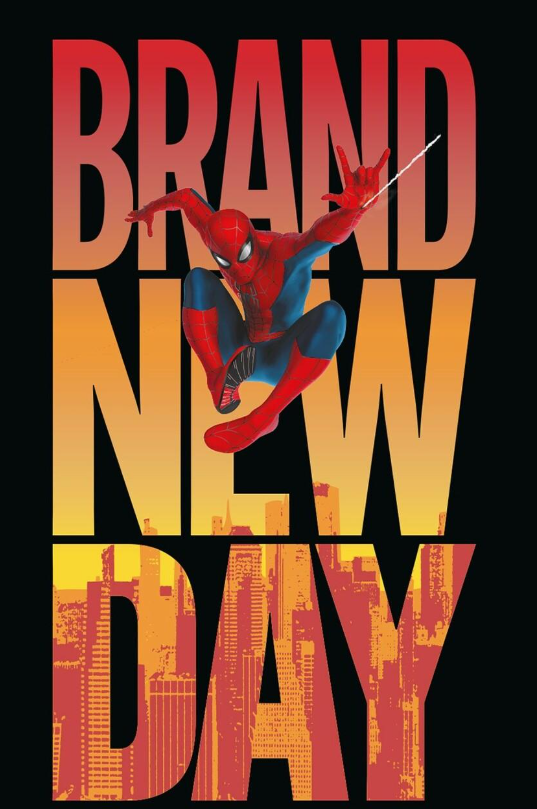
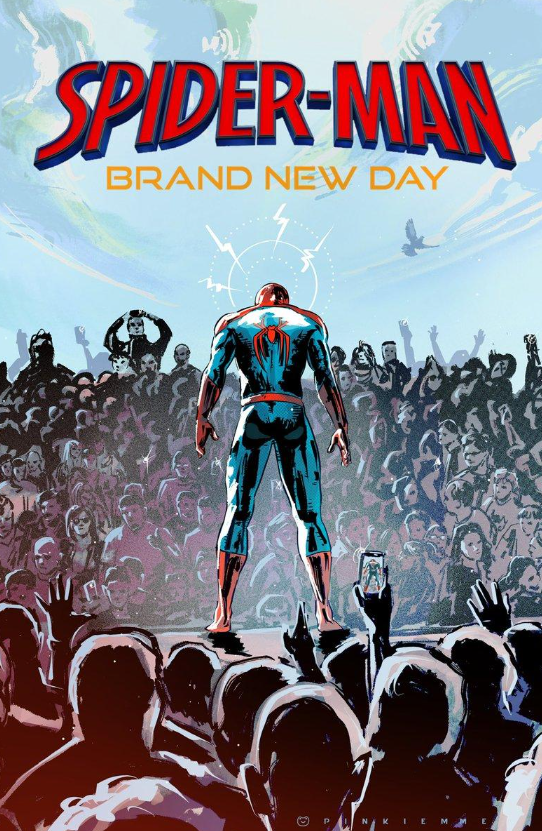

<div align="center">



# 🕷️ A BRAND NEW DAY

### *The Same Curiosity to Build.*

**Suyash Shirsat** · Electronics & Telecommunication Engineering

[](https://github.com/Sushantaman108Durgadas)
[](https://www.linkedin.com/in/suyash-shirsat-771476335/)
[](mailto:suyashshirsat8@gmail.com)

<br/>

**Embedded Systems · Firmware · IoT · Signal Processing · Machine Learning · Digital Hardware**

</div>

---

## THE BEGINNING

Hey, I'm **Suyash** — an Electronics & Telecommunication engineering student interested in building systems where hardware, firmware, signals and software come together.

I enjoy understanding how things work beneath the abstraction: writing embedded logic, interfacing sensors, processing real-world signals, experimenting with learning algorithms and bringing separate components into a working system.

This GitHub profile is a record of projects, experiments and engineering work that I have built or contributed to. Some are individual explorations; others are collaborative academic projects. I try to make that distinction clear.

> **A Brand New Day. The Same Curiosity to Build.**

---

## THE WORK — FEATURED PROJECTS

These repositories best represent the areas I've explored so far.

### 01 · WearTwin — Wearable Monitoring & Digital Twin Prototype

[](https://github.com/Sushantaman108Durgadas/WearTwin)

**ESP32 · PPG · IMU · Signal Processing · Python · Denoising Autoencoder**

An ongoing wearable-monitoring and Digital Twin prototype focused on physiological and functional-state monitoring.

Work in the repository includes:
- PPG data acquisition and preprocessing workflows.
- Stationary and motion-affected PPG recording analysis.
- Signal filtering, feature extraction and derived metrics.
- Exploration of a 1D convolutional denoising autoencoder.
- A software pipeline intended to support physiological-state analysis and a Digital Twin prototype.

*Status: Ongoing project. Sensor integration and system capabilities are being developed iteratively.*

---

### 02 · Smart Home Guard — Embedded Security System

[](https://github.com/Sushantaman108Durgadas/SmartHomeGuard_MPR2A)

**ESP32 · STM32 · Embedded C++ · FSM · UART · Firebase · Wokwi**

A Semester 5 mini-project that evolved from an ESP32 simulation into a multi-controller home-security prototype.

Work documented in the repository includes:
- Object-oriented embedded C++ design.
- Finite State Machine (FSM) logic for security states and transitions.
- Door monitoring using a magnetic reed switch.
- Motion detection using a PIR sensor.
- ESP32–STM32 communication over UART.
- Firebase telemetry and MIT App Inventor mobile-app integration.
- Wokwi simulation iterations for testing the embedded logic.

The project was developed collaboratively. The repository documents the team's evolution and implementation.

---

### 03 · Obstacle Detecting Gimbal — 2-Axis Spatial Scanning

[](https://github.com/Sushantaman108Durgadas/Obstacle_Detecting_Gimbal)

**ESP32 · Embedded C++ · Servo Control · Ultrasonic Sensing · Wokwi**

A two-axis servo gimbal that scans a configurable angular region using ultrasonic distance measurements.

Key implementation areas:
- Independent horizontal and vertical servo positioning.
- Configurable angular scanning limits.
- Distance measurement at scan positions.
- Spherical-to-Cartesian coordinate transformation.
- Modular, object-oriented C++ design.
- Wokwi simulation and a reproducible VS Code / Arduino CLI setup.

---

### 04 · Machine Learning From Scratch

[](https://github.com/Sushantaman108Durgadas/ml_from_scratch)

**C++ · GNU Octave · Neural Networks · SOFM · CNN**

An implementation-oriented exploration of machine-learning fundamentals, with an emphasis on understanding algorithmic operations rather than relying entirely on high-level frameworks.

The repository contains:
- **Supervised learning:** a feedforward neural network trained on the XOR problem.
- **Unsupervised learning:** a Self-Organizing Feature Map (SOFM), including Best Matching Unit selection and neighbourhood weight updates.
- **Deep learning:** a CNN experiment for classifying hand-coded 9×9 digit templates.

---

### 05 · Smart Dustbin — Intelligent Waste Monitoring

[](https://github.com/Sushantaman108Durgadas/Smart-Dustbin-Project-MPR1B)

**Embedded C/C++ · ESP32 · ESP8266 · Arduino · Blynk · ThingSpeak · Wokwi**

A collaborative mini-project repository documenting the evolution of a smart dustbin from basic automation to connected monitoring and more advanced simulated logic.

The repository contains multiple project iterations, including:
- Automatic lid operation and fill-level sensing.
- IoT connectivity and remote monitoring.
- Blynk and ThingSpeak integrations.
- Object-oriented simulation work.
- Radar-style scanning and area-based waste-level analysis.

*This is a forked/team project repository. The repository history and project versions should be read in that collaborative context.*

---

## THE ENGINEERING — AREAS I'VE WORKED IN

### Embedded Systems & Firmware

- Embedded C and C++.
- ESP32 / ESP8266 and STM32 development.
- GPIO and sensor interfacing.
- UART, I²C and SPI fundamentals.
- Interrupt-driven logic and finite state machines.
- Object-oriented and modular firmware design.
- Arduino IDE, Arduino CLI and Wokwi.

### Signals, Image Processing & Machine Learning

- Digital signal processing concepts and filtering.
- PPG preprocessing and signal-quality exploration.
- Image enhancement and histogram processing.
- Histogram stretching and histogram equalization.
- MATLAB / GNU Octave experiments.
- Neural networks, SOFM and CNN fundamentals.
- Python-based machine-learning experiments.

### Digital Systems & FPGA

- Digital logic design.
- Verilog and VHDL fundamentals.
- FPGA development and pin constraints.
- Numato Mimas V2 board work.
- Xilinx ISE and HDL simulation workflows.

### IoT & Connected Systems

- Wi-Fi-enabled microcontroller projects.
- Firebase Realtime Database integration.
- Blynk and ThingSpeak.
- Bluetooth-based mobile-app interaction.
- Device-to-device communication and telemetry concepts.

---

## ACADEMIC WORK & EXPERIMENTS

Alongside project repositories, I've explored engineering concepts through coursework, laboratory implementations and focused experiments.

| Area | Work / concepts explored |
|---|---|
| Neural Networks | Feedforward networks, XOR learning, SOFM and CNN experiments |
| Image Processing | Histogram stretching, histogram equalization and image enhancement |
| Digital Systems | Verilog / VHDL and FPGA-oriented laboratory work |
| Signal Processing | Filtering, signal analysis and PPG preprocessing |
| Machine Learning | Classification experiments, including a Kepler exoplanet ML assignment |
| Computer Networks | Networking fundamentals and communication protocols |

This section represents academic and experimental work; not every item is a standalone public repository.

---

## THE TOOLKIT

<div align="center">


<br/><br/>


</div>

| Category | Technologies / tools |
|---|---|
| Languages | C, C++, Python, MATLAB / Octave, Verilog, VHDL |
| Microcontrollers | ESP32, ESP8266, STM32 |
| Embedded tooling | Arduino IDE, Arduino CLI, Wokwi |
| Signal & ML work | GNU Octave, Python, NumPy / scientific Python workflows |
| IoT | Firebase, Blynk, ThingSpeak, Bluetooth, Wi-Fi |
| Digital hardware | FPGA, Numato Mimas V2, Xilinx ISE |
| Development | VS Code, Git, GitHub, Linux |

*The toolkit reflects technologies used across projects and experiments; it is not a claim of equal proficiency in every item.*

---

## WHAT I'M BUILDING TOWARDS

My current direction is to deepen the fundamentals behind reliable embedded and intelligent systems.

- **Embedded firmware:** stronger C/C++, peripheral drivers, interrupts, RTOS concepts and real-time design.
- **Microcontroller platforms:** continued work with ESP32 and STM32.
- **Signal intelligence:** robust signal preprocessing, feature engineering and ML-assisted analysis.
- **Digital design:** stronger RTL design, verification and FPGA implementation.
- **Connected devices:** dependable communication, telemetry and IoT system architecture.

These are learning directions and goals, not a list of completed projects.

---

## THE NEXT CHAPTER

I believe good engineering comes from repeatedly moving between theory and implementation:

```text
       UNDERSTAND THE PROBLEM
                 │
                 ▼
          DESIGN THE SYSTEM
                 │
                 ▼
          BUILD A PROTOTYPE
                 │
                 ▼
           TEST & DEBUG
                 │
                 ▼
         LEARN AND IMPROVE
                 │
                 └───────────────► REPEAT
```

---

## GITHUB ACTIVITY

<div align="center">


<br/><br/>


</div>

---

## CONNECT

I'm always happy to connect with people interested in embedded systems, firmware, IoT, signal processing and practical engineering.

<div align="center">

[](https://github.com/Sushantaman108Durgadas)
[](https://www.linkedin.com/in/suyash-shirsat-771476335/)
[](mailto:suyashshirsat8@gmail.com)

</div>

---

<div align="center">



### **A BRAND NEW DAY. THE SAME CURIOSITY TO BUILD.**

*Keep learning. Keep building. Keep beginning again.*


</div>
